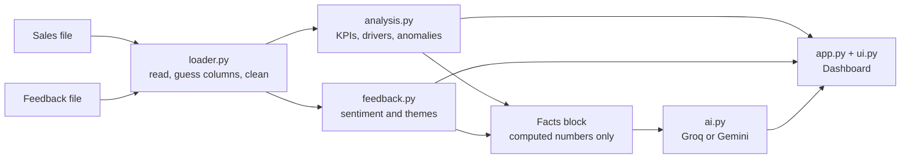

<div align="center">

# ⚡ DecisionAI (Dino-Doc)
### AI Business Strategy & Executive Decision Intelligence Platform

*Upload sales and feedback files. Get what changed, why it changed, and what to do next.*


<!-- Add a screenshot or GIF of the dashboard here:   -->

</div>

---

## 🎯 The problem

Business leaders have to read sales reports, customer comments and financial numbers before every decision. It is slow, and important changes get missed.

**DecisionAI** reads the data for them. It compares two periods, finds the biggest movers, explains whether the cause is **volume** or **price**, reads customer sentiment, flags anomalies, and writes an executive summary with recommendations.

> **Core idea:** Python does all the maths. The LLM only explains the computed results, so it cannot invent numbers.

---

## ✨ Features

| | Feature | What you get |
|---|---|---|
| 📂 | **Any file works** | CSV or Excel, any column names. Columns are auto-detected and can be changed in the sidebar. |
| 🧹 | **Auto cleaning** | `₹1,20,000` becomes a number, mixed date formats are parsed, bad rows are skipped and reported. |
| 📊 | **KPIs** | Revenue, profit, margin, units, average price, orders, average order value. |
| 🔁 | **Period comparison** | Quarter vs quarter or month vs month. |
| 🛡️ | **Partial period guard** | Incomplete periods are marked and never chosen by default, so there are no fake "crashes". |
| 🔍 | **Why it changed** | Revenue change per segment, split into a volume effect and a price/mix effect. |
| 🚨 | **Anomaly detection** | Flags months more than 25% away from a segment's previous 3-month average. |
| 💬 | **Customer feedback** | Sentiment (VADER) and themes: delivery, pricing, support, quality, ease of use. |
| 🎛️ | **Scenario analysis** | Price, volume and unit-cost sliders, with optional price elasticity. |
| 🤖 | **AI summary and chat** | Executive summary, risks, opportunities, recommendations, and a Q&A assistant. |
| 🎨 | **Animated UI** | Neon dark theme, animated hero, glass KPI cards, themed charts. |

---

## 🧠 How it works



### The "why did revenue change" logic

For every region and product:

```
volume_effect    = (units_now − units_before) × price_before
price_mix_effect = total revenue change − volume_effect
```

A large volume effect points to demand or supply problems. A large price/mix effect points to discounting or product mix.

### Why the AI does not hallucinate

1. Python computes every number.
2. Only a short **facts block** is sent to the model, never the raw data. It is visible in the app under *Facts sent to the AI*.
3. The system prompt tells the model to use only those facts, copy numbers exactly, and say so when something is missing (for example no cost data, or a partial period).

---

## 📁 Project structure

```
decision-ai/
├── app.py              # dashboard: ties everything together
├── theme.py               # CSS, animated hero, KPI cards, chart theme
├── loader.py           # read any CSV/Excel, guess columns, clean data
├── analysis.py         # KPIs, comparison, drivers, anomalies, coverage
├── feedback.py         # sentiment and theme tagging
├── ai.py               # Groq / Gemini client
├── generate_data.py    # creates the built-in sample data
├── data/               # sales.csv, feedback.csv (built-in sample)
├── demo/               # demo_sales.csv, demo_feedback.csv (put the demo files here)
├── .streamlit/config.toml
├── requirements.txt
└── .env                # your API key (never commit this)
```

---

## 🚀 Quick start

```bash
# 1. create and activate a virtual environment
python -m venv .venv
.venv\Scripts\activate            # Windows
source .venv/bin/activate         # Mac / Linux

# 2. install
python -m pip install -r requirements.txt

# 3. (optional) create the built-in sample data
python generate_data.py

# 4. run
python -m streamlit run app.py
```

### 🔑 Free AI key

Create a `.env` file in the project folder:

```env
AI_PROVIDER=groq or gemini
GROQ_API_KEY=your_key_here
GROQ_MODEL=working model
```

Prefer Gemini? Use `AI_PROVIDER=gemini` and `GEMINI_API_KEY=your_key_here`.

- Groq keys: [console.groq.com](https://console.groq.com)
- Gemini keys: [aistudio.google.com](https://aistudio.google.com)
- Model names change often. If you see "model not found", check the provider's current model list and update `GROQ_MODEL` or `GEMINI_MODEL`.

Without a key, everything except the AI summary and chat still works.

---

## 🎬 Try the demo

Upload the files in `demo/`:

| Field | Column in `demo_sales.csv` |
|---|---|
| Date | Order Date |
| Revenue | Sales Amount |
| Cost | Cost Price |
| Units | Qty |
| Region | Branch |
| Product | Item Category |

`demo_feedback.csv` uses `Customer Comment` (text) and `Review Date` (period).

With the demo files, **2026Q3 vs 2026Q2** shows:

| Insight | What to look for |
|---|---|
| Revenue about **-6%** while units grow | Average price fell about 10%, which points to discounting |
| Biggest decline | **Chennai · Electronics**, mostly a volume loss |
| Biggest growth | **Bengaluru · Home** |
| Anomaly | **Hyderabad, March 2026**, a spike across all categories |
| Feedback | Negative comments rise in Q3, with **delivery** the top complaint |

---

## 📄 Using your own data

**Sales file** (any names, these are the fields the app looks for):

| Field | Required | Example column names |
|---|---|---|
| Date | ✅ | Date, Order Date, Month |
| Revenue | ✅ | Revenue, Sales Amount, Total Amount |
| Cost | optional | Cost, Cost Price, COGS |
| Units | optional | Units, Qty, Quantity |
| Region | optional | Region, Branch, State, City |
| Product | optional | Product, Item Category, SKU |

**Feedback file:** a comment column (required) and a date or period column (optional). Without a date column, all comments are assigned to the current period.

Missing optional columns are handled: no cost hides profit and margin, no units hides the volume/price split, and no region or product groups everything as one segment.

---

## ⚠️ Limitations

- The built-in and demo data are **synthetic**.
- Sentiment and theme tagging are **rule-based** (VADER and keywords), not a trained model.
- Scenario results use a simple assumption (price elasticity of -1.2), not a forecast.
- Column auto-detection is a guess. Check the mapping in the sidebar.
- The partial-period check looks at the first and last dates, so gaps inside the data are not detected.
- Free AI tiers have rate limits and may use prompts to improve their products, so avoid confidential data.

---

## 🛣️ Roadmap

- [ ] Forecasting (Prophet or ARIMA)
- [ ] Transformer-based sentiment and topic modelling
- [ ] Database connection
- [ ] PDF export of the executive summary
- [ ] Saved reports and login

---

## 🧰 Tech stack

Python · Pandas · NumPy · Plotly · Streamlit · VADER Sentiment · Groq / Google Gemini · HTML/CSS/Canvas (UI)

---

<div align="center">

Built by **Pravin** · [LinkedIn](https://www.linkedin.com/in/pravinkumar-u) · [GitHub](#)

</div>
